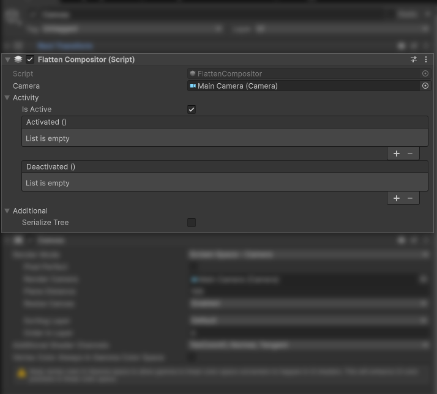
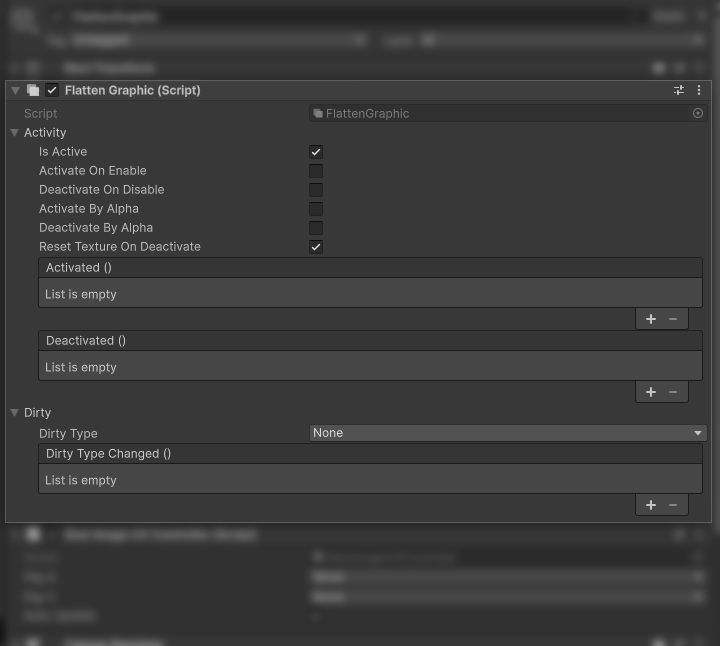
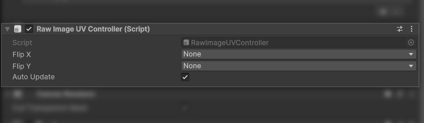
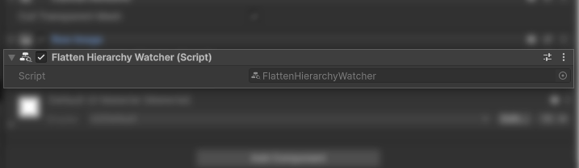
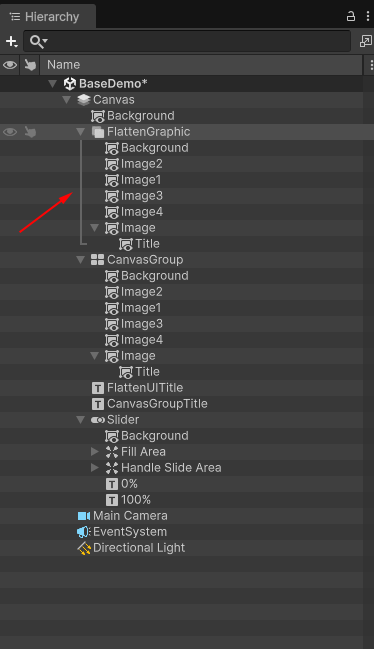

# FlattenUI

  

A non-intrusive UGUI compositing and branch-baking system for Unity (URP). Flatten complex UI hierarchies into pooled offscreen textures on demand — fixing `CanvasGroup` overlapping alpha-blending artifacts and collapsing multi-element UI branches into a single draw call.

<p align="center">
  
</p>

## Requirements

- **Unity 2022.3 LTS** or newer *(Custom Hierarchy window visualization requires **Unity 6.3+** or the `com.unity.hierarchy` package)*.
- **Universal Render Pipeline (URP)** (uses `UniversalRenderPipeline.SingleCameraRequest`).

## Installation

1. Download and purchase **FlattenUI** from the [Unity Asset Store](https://assetstore.unity.com/packages/slug/430314) (or via short link [u3d.as/4jzo](https://u3d.as/4jzo)).
2. Open `Window > Package Manager`, switch to **My Assets**, and click **Import**.

## Quick Start

1. Select your **Root Canvas** GameObject and add the **`FlattenCompositor`** component (`Add Component > FlattenUI > Flatten Compositor`).
2. Select any child UI branch you want to flatten and add the **`FlattenGraphic`** component (`Add Component > FlattenUI > Flatten Graphic`).
3. *(Recommended)* Add **`RawImageUVController`** to the same branch GameObject so it automatically maps the `RawImage` UV coordinates to the element's screen bounds. Make sure the `FlattenGraphic`'s `RectTransform` size covers all of its child elements so nothing gets clipped.
4. Enable **`Is Active`** on both `FlattenCompositor` and `FlattenGraphic`.

## Components

### 1. FlattenCompositor (Root Canvas)



Attach this component to your **Root Canvas**. It manages the internal node hierarchy, processes queued rebuilds, and executes the URP offscreen baking pass during `Canvas.preWillRenderCanvases`. It automatically resolves the rendering camera from the Canvas world camera or falls back to `Camera.main`.

- **Activity:**
  - **Is Active:** Globally enables or disables flattening for all managed branches under this Canvas.
  - **Activated / Deactivated:** UnityEvents invoked when the compositor is enabled or disabled.
- **Additional (Editor Only):**
  - **Serialize Tree:** Preserves the internal node tree across script recompilations and domain reloads.
  - **Rebuild On Hierarchy Changed:** Automatically schedules a node tree rebuild in Edit Mode whenever the scene hierarchy changes.

### 2. FlattenGraphic (UI Branch Baker)



Attach this component to the parent GameObject of any UI subtree. It requires a **`RawImage`** component on the same GameObject, culls child graphics from normal Canvas rendering when active, and outputs the baked composite texture into the `RawImage`.

- **Activity:**
  - **Is Active:** Activates or deactivates flattening for this specific UI branch. When inactive, child UI elements render normally.
  - **Activate On Enable / Deactivate On Disable:** Automatically toggles flattening when the GameObject or component is enabled or disabled.
  - **Activate By Alpha / Deactivate By Alpha:** Monitors `RawImage.color.a` in real time. Automatically activates flattening when alpha drops below `1.0` (e.g., during a fade transition) and deactivates it once alpha returns to `1.0`.
  - **Reset Texture On Deactivate:** Immediately releases the allocated `RenderTexture` back to the shared pool when deactivated to minimize memory usage.
  - **Activated / Deactivated:** UnityEvents invoked when flattening is activated or deactivated on this branch.
- **Dirty:**
  - **Dirty Type:** Controls when the branch texture is re-baked:
    - **None:** Uses the cached `RenderTexture` without re-baking (0 rendering overhead).
    - **Marker:** Bakes the branch once on the next frame and automatically resets back to **None**.
    - **Always:** Re-bakes the branch every frame while active (ideal for continuous animations inside the branch).
  - **Dirty Type Changed:** UnityEvent invoked whenever `Dirty Type` changes.

### 3. Companion Components

<table>
  <tr>
    <td>
      
    </td>
    <td>
      
    </td>
  </tr>
</table>

- **RawImageUVController:** *(Optional, Strongly Recommended)* While not enforced via `[RequireComponent]` so advanced users can implement custom UV logic, you should attach this component alongside `FlattenGraphic` for standard UI setups. Because offscreen baking uses a full-screen `RenderTexture`, `RawImageUVController` calculates the exact screen-space UV coordinates (`RawImage.uvRect`) matching the branch's `RectTransform`. This optimizes rendering by drawing only the cropped region of the texture rather than a full-screen quad.
  - **Important:** Ensure the `RectTransform` of your `FlattenGraphic` encompasses all child UI elements — any child geometry extending outside the parent `RectTransform` bounds will be clipped by the UV crop.
  - **Flip X / Flip Y:** Mirrors the UV coordinates horizontally or vertically (`None`, `Local`, `Global`).
  - **Auto Update:** Automatically recalculates UV bounds whenever the `RectTransform` moves or resizes.
- **FlattenHierarchyWatcher:** *(Optional)* Attach it to a dynamic UI element to automatically detect parent changes (`OnTransformParentChanged`) and notify the compositor to rebuild the affected branches.

### 4. Hierarchy Window Integration (Unity 6.3+)



When using Unity's new Hierarchy window, **FlattenUI** draws branch connector lines that visualize the baking composition — clearly showing which child elements are baked into which `FlattenGraphic` (including nested `FlattenGraphic` branches baked into parent branches).

## Scripting API

```csharp
using FlattenUI;
using UnityEngine;
using UnityEngine.EventSystems;
using UnityEngine.UI;

[RequireComponent(typeof(FlattenGraphic))]
public class StickerCardView : MonoBehaviour, IPointerClickHandler
{
    /*
     * Hierarchy:
     * StickerCard (GameObject) [RawImage, FlattenGraphic, RawImageUVController, StickerCardView]
     * └── InnerIcon (GameObject with UI Image) <-- _innerIcon
     */

    [SerializeField] private Image _innerIcon;

    public void OnPointerClick(PointerEventData eventData)
    {
        // Change a graphic inside the baked branch.
        _innerIcon.color = Random.ColorHSV();

        // Update the cached texture to reflect the change.
        GetComponent<FlattenGraphic>().MarkDirty();
    }
}
```

### `ActivatableComponent` (Base class for `FlattenCompositor` & `FlattenGraphic`)

| Member | Description |
| :--- | :--- |
| `bool IsActive { get; }` | Indicates whether the component is currently active. |
| `event Action Activated` | Invoked after the component has been activated. |
| `event Action Deactivated` | Invoked after the component has been deactivated. |
| `void Activate()` | Activates the component if inactive and invokes `Activated` callbacks. |
| `void Deactivate()` | Deactivates the component if active and invokes `Deactivated` callbacks. |

### `FlattenGraphic`

| Member | Description |
| :--- | :--- |
| `FlattenCompositor Compositor { get; }` | Returns the `FlattenCompositor` managing this branch, or `null` if unbound. |
| `DirtyType DirtyType { get; }` | Current invalidation mode (`None`, `Marker`, or `Always`). |
| `bool IsDirty { get; }` | `true` when `DirtyType != DirtyType.None`. |
| `event Action<DirtyType> DirtyTypeChanged` | Invoked whenever `DirtyType` changes. |
| `void SetDirtyType(DirtyType type)` | Sets the dirty state and updates the rendering subscription in the compositor. |
| `void MarkDirty()` | Sets `DirtyType.Marker` to bake once next frame (unless already set to `Always`). |
| `void ResetDirty()` | Clears the state to `DirtyType.None` (unless set to `Always`). |
| `void SetAlwaysDirty()` | UnityEvent-friendly helper that sets `DirtyType.Always`. |
| `void SetMarkerDirty()` | UnityEvent-friendly helper that sets `DirtyType.Marker`. |
| `void SetNoneDirty()` | UnityEvent-friendly helper that sets `DirtyType.None`. |
| `void Bake()` | Immediately applies pending rebuilds and bakes this branch into its `RenderTexture`. |
| `void Rebuild()` | Schedules a deferred hierarchy rebuild for this graphic's node in the compositor. |
| `void RebuildImmediate()` | Immediately rebuilds this graphic's node subtree in the compositor. |

### `FlattenCompositor` & Extensions

| Member | Description |
| :--- | :--- |
| `void Rebuild()` | Schedules a deferred full tree rebuild for the compositor. |
| `void Rebuild(Transform transform)` | Queues a deferred subtree rebuild for the specified `Transform` in the compositor tree. |
| `void RebuildImmediate()` | Immediately rebuilds the entire node tree managed by the compositor. |
| `void RebuildImmediate(Transform transform)` | Immediately rebuilds the subtree of the specified `Transform` in the compositor tree. |

### `FlattenRenderer`

| Member | Description |
| :--- | :--- |
| `static bool IsRendering { get; }` | Returns `true` while an offscreen flatten render pass is actively in progress. Useful for ignoring state changes or layout callbacks triggered during baking. |

### `RawImageUVController`

| Member | Description |
| :--- | :--- |
| `void UpdateUV()` | Manually recalculates and applies `RawImage.uvRect` based on the current `RectTransform` bounds relative to the Canvas (does not trigger a re-bake). |

## Credits & License

Developed by [Muviton](https://github.com/MUVITON).

Released under the Unity Asset Store EULA.